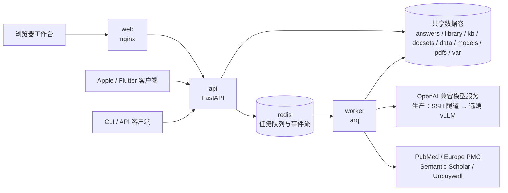

# 架构与关键设计

本文回答「系统由哪些部分组成、为什么这样拆、改动时哪些约束不能破」。部署步骤见 [deployment.md](deployment.md)，环境变量见 [configuration.md](configuration.md)，HTTP 协议见 [api.md](api.md)。

## 组件

| 目录 | 包 / 产物 | 职责 |
|---|---|---|
| `core/` | `picoseek-core` + `./PicoSeek` CLI | 检索、全文获取与解析、PICOS 逐篇阅读、引文核实、原子知识库、期刊分区。不感知 HTTP。 |
| `backend/` | `picoseek-backend`（命令 `picoseek`） | FastAPI 路由、SQLite/Alembic、arq worker、PDF 导出。复用 `core/`，不另写检索或问答逻辑。 |
| `frontend/` | `picoseek-web` 镜像 | React 浏览器工作台，nginx 同源代理 `/v1`。 |
| `apple/`、`flutter/` | 原生客户端 | 与 Web 功能对等，直接调用 `/v1`。 |

根 `pyproject.toml` 是 uv workspace，成员为 `core` 与 `backend`；CLI、API、worker 共用同一个 `.venv`。

后端分层：`backend/app/routers/` 只负责 HTTP 校验、鉴权和序列化；`backend/app/services/` 承担业务逻辑；`core/` 不感知 HTTP。

## 为什么 API 与 worker 分离

问答流水线通常运行数分钟，API 只接收请求、持久化任务并入队，worker 执行耗时工作。`PICOSEEK_WORKER_MAX_JOBS` 默认 `1`，对应单 GPU 串行执行。

- **事件流用 Redis Stream 而非 Pub/Sub**：SSE 客户端断线后要携带 `Last-Event-ID` 续传历史事件。
- **取消是协作式的**：API 写入取消标记，worker 在阶段边界和逐篇处理边界检查；已经开始的单次 LLM 调用不会被强行中断。
- **数据库迁移不在进程启动时执行**：Compose 的 `migrate` 服务先跑 Alembic，成功后 `api` 与 `worker` 才启动。

## 三个问答引擎

`POST /v1/answers` 的 `engine` 决定 worker 走哪条路；`interpret` 不接受 JSON 创建，只能经 `POST /v1/answers/interpret`（multipart）上传 PDF 建立。

| | `ask`（默认） | `codex` | `interpret` |
|---|---|---|---|
| 执行方式 | 固定流水线：检索 → 取全文 → 逐篇阅读 → 综合 | Codex agent 自己决定调哪些工具 | 解析上传的 PDF → 一次模型调用产出综述或回答 |
| 文献来源 | 检索 PubMed / Europe PMC 等上游 | agent 自主检索 | 用户上传的 1..10 篇 PDF（`PICOSEEK_INTERPRET_MAX_FILES`） |
| 工具面 | 流水线内部直接调 `core/literature.py` 等 | core 的 `semantic_scholar` MCP（与 `./PicoSeek codex` 同一套） | 无外部工具，只读上传件 |
| 产出 | `body_md` 分节 + 逐篇原文快照 + 段落级引用 | 整篇 `answer_md` + `trace`（结构化工具调用轨迹），无原文快照 | 同 `ask` |
| 生效筛选 | 全部字段，服务端硬过滤 | 年份/分区/期刊等翻成检索要求交给模型 | 不适用 |
| 多轮 | 每次提问独立 | 同一 codex 会话可 `POST /v1/answers/{id}/followup` 续接 | 同一 docset 可 `followup` 续接，解析产物复用 |

### `ask`：全文级联与引文核实

全文按 PMC XML → Unpaywall PDF → 机构订阅 PDF 的顺序获取，都拿不到就退回摘要；`pdfs/` 下的本地 PDF 不参与级联，只是 codex `read_pdf` 工具的输入。机构订阅需要管理员先上传登录态（[api.md §4.6](api.md#46-paywall)）。

全文被切成带编号的段落；模型阅读时每条发现必须写成 `(¶12: "原文逐字引用")`，程序用模糊匹配回到原文核对，综合答案里的引用变成 `[n¶pid]` 段落定位。细节见 [core/README.md §1.2](../core/README.md#12-引文定位到原文段落)。

### `codex` 运行时

codex 运行时随 `openai-codex` 依赖进镜像（`openai-codex-cli-bin` 自带二进制，不需要 node，也不读 `~/.codex/config.toml`）。provider 与 MCP 全部走每次会话的内联配置，复用 `LLM_BASE` / `LLM_MODEL` / `LOCAL_QWEN_KEY`，因此模型端点必须支持 **Responses API**（`/v1/responses`）——codex 0.147 起不再支持 chat 线协议。系统指令来自 `core/AGENTS.md`（CLI 的 `./PicoSeek codex` 也从工作目录加载同一份）。会话文件落在 `CODEX_HOME`（镜像内 `/data/var/codex`，随 `./var` 卷持久化）。

服务端以 `sandbox=read-only` + `approval_mode=deny_all` 启动，工作目录是 `CODEX_HOME/work` 空目录。这两项只挡住写入与升权：**read-only 不限制读取范围**，真正的租户隔离靠容器与运行用户，多租户对外开放前必须在容器/进程层面隔离。

### `interpret`：文献解读

一次上传的一组 PDF 叫一个 **docset**，它的 id 就是会话的 `thread_id`，文件落在 `PICOSEEK_DATA/docsets/<thread_id>/`：`<n>.pdf` 是原件，`<n>.md`（带段落锚点）与 `<n>_paragraphs.json` 是第一次解析的产物，追问直接复用。`manifest.json` 记录编号、文件名与解析出的标题 / DOI / 段落数。删除会话最后一轮时整个 docset 目录一并清除；已写入 `library/` 与 kb 的副本不受影响。

- 上传 2..10 篇且带问题时，API 一次入队两轮：第一轮固定是综述（「文献概览 / 组织关系 / 差异对照 / 总结」四个模块），第二轮才是用户的问题。因为占两个名额，`PICOSEEK_MAX_ACTIVE_JOBS_PER_USER` 必须 ≥ 2（默认即为 2）。只传 1 篇时必须给出问题，直接进问答模式。
- 首轮 `use_kb=true`，上传的 PDF 经 `answer_kb` 后台任务进共享文献库与知识库（`source=upload`）；追问只读不写。
- 送入模型的正文按 `min(60000, 360000 // 篇数)` 字符逐篇截断，段落列表与原文快照保留完整。SSE 阶段只有 `fulltext` 与 `synthesize`。
- 创建入口只在 Web；Apple / Flutter 只做最小兼容：渲染解读答案、显示「解读」徽标与两节点进度、在会话上继续提问。

## 答案先交付，知识后台入库

`ask` 开启 `use_kb` 时，API 在同一数据库事务中保存 `Answer.ready`、问答任务成功及独立的 `answer_kb` 后台任务；`job.result.kb_job_id` 指向后台任务。答案和逐篇原文此时已经可读，后台失败或取消不会改写、撤回答案。`use_kb=false` 不创建后台任务；`kb_hits` 只引用既有知识，不等待本次入库。

后台任务的约束：

- 由数据库持久任务驱动，worker 启动时和每 10 秒扫描恢复，Redis 投递失败不会丢任务。
- 每次只处理一篇；有其他种类任务排队或运行时不派发下一篇。已开始的一篇不会被抢占，所以新问答最多等当前这一篇。
- 事实抽取完成后原子保存检查点，重试可复用；每篇最多尝试 3 次，逐篇保存恢复游标。取消不回滚此前已写入的文献。
- `var/answer-kb.lock` 保证跨进程后台串行，运行期间不要删除。

本机 CLI 不走后台队列，仍同步抽取与索引。

## 知识库与 CLI 共存

`./PicoSeek` 与 worker 调用同一套 `core/` 代码，可通过 `PICOSEEK_DATA` 共用同一份 `answers`、`library`、`kb` 数据。

- 写入由数据根目录下的 `kb.lock`（`flock`）协调。重建从读取 `library/` 到发布索引全程持有写锁，新增入库会等待；搜索不持写锁，单次检索内固定使用同一代向量与元数据。
- 索引是单个 `kb/index.npz` 快照，换代靠一次原子 rename。重建在等锁、逐篇处理和发布前检查取消标记，取消或超时后未发布的快照被丢弃。
- 多个 worker 或 CLI 共享数据时，共享文件系统必须支持 POSIX 文件锁与原子重命名；不要混用不遵循该锁协议的旧版写者。
- 索引记录 embedder 名称；进程的 embedder 与索引不一致时 `search` / `add_paper` 抛 `EmbedderMismatch`，需要重建（见 [core/README.md §6](../core/README.md#6-环境与配置)）。

## 模型调用策略

- 检索、阅读、事实抽取显式关闭思考，综合阶段开启思考；codex 使用服务端默认思考。
- 各阶段均不发送 `thinking_token_budget` 或 `max_tokens`，由 vLLM 按剩余上下文分配生成额度；输入、思考和正文共享模型总上下文。
- 综合请求取消读取超时（连接、写入、连接池等待仍为 30 秒）；其他阶段读取超时 600 秒。长思考可能占用单卡数小时，因此生产把 `PICOSEEK_JOB_TIMEOUT_S` 设为 `86400`；不要设为 `0`（队列会立即超时）。
- 空正文或 `finish_reason=length` 会让任务明确失败，不会保存为完成答案。
- 每次尝试输出一行 `llm_metrics {JSON}` 日志（沿用 `log` 事件），字段有 `stage`、`operation`、`request_id`、`attempt`、`model`、`response_id`、`success`、`elapsed_s`、`finish_reason` 及服务端返回的 `prompt_tokens`、`completion_tokens`、`reasoning_tokens`、`cached_tokens`；缺失用量为 `null`。`elapsed_s` 是客户端单次调用总耗时，不能拆分排队、预填充与解码。日志不含提示词、回答正文或密钥。后台事实抽取的日志归属 `answer_kb` 任务。

## 导出 PDF

三端拿到同一份文件：排版只在服务端做一次（`GET /v1/answers/{id}/pdf`，Chromium 打印 `backend/app/export/answer.html.j2`），客户端只负责保存或分享。三套 UI 排版引擎不可能产出一致的 PDF，所以不在客户端出稿。

- 正文分节规则有四份逐字同源的实现，改规则要四处一起改：`backend/app/export/sections.py`、`frontend/src/lib/answerSections.ts`、`apple/PicoSeekKit/Sources/PicoSeekKit/Logic/AnswerSections.swift`、`flutter/lib/core/logic/answer_sections.dart`。
- 段落级引用渲染成彩色芯片并链到文末「引用原文」附录，另含参考文献、知识库补充与检索式；`relevance == 0` 且正文未引用的文献不导出。
- 中文字形依赖 runtime 镜像里的 `fonts-noto-cjk` 与 `fonts-inter`；本机未装字体只影响字形。
- 文件名由 `Content-Disposition` 的 `filename*` 决定（`PicoSeek-<日期>-<问题>.pdf`）。iOS 与 Android 走分享面板，macOS 与桌面 Flutter 走保存面板，Web 直接下载。

## 账号与权限

只有 `user` 和 `admin` 两种角色，不开放注册。账号的创建与重置见 [deployment.md](deployment.md#账号管理)，请求细节见 [api.md §1.2](api.md#12-鉴权)。

| 角色 | 权限边界 |
|---|---|
| `user` | 创建和读取自己的问答、任务与阅读材料，取消自己的任务、删除自己的终态答案；共享读取文献、KB、期刊与上游检索 |
| `admin` | 具备普通用户能力，可查看和管理所有问答及任务、重建 KB、创建账号、启用/禁用账号与重置密码 |

- 账号只能启用/禁用，不能删除或改角色；禁止禁用自己或最后一个活跃管理员。禁用不删除已有问答，也不取消已排队或执行中的任务。
- 健康探针、API 描述（`/v1/openapi.json`）与登录端点免鉴权，其余接口都要登录。
- 登录返回随机 Bearer 令牌，固定有效期（默认 7 天），不续期；数据库只存 SHA-256 摘要。改密、重置、禁用都会撤销该账号全部会话，重新启用不恢复旧令牌。
- 所有受保护端点（含 SSE）只接受 `Authorization` 请求头，不接受 URL 令牌，所以浏览器不能用原生 `EventSource`。
- 个人问答私有，但文献和衍生知识共享；知识抽取以问题作为上下文，这不是严格的隐私或租户隔离，不应提交敏感个人或患者信息。

## 数据目录

`PICOSEEK_DATA` 决定所有运行期数据的位置：本地未设置时为 `core/`，容器内为 `/data`。以下目录都不入库。

| 子目录 | 内容 |
|---|---|
| `answers/` | 每次问答的综述与逐篇材料（`<id>_papers/`） |
| `library/<key>/` | 逐篇规范化全文、段落、原子事实与元数据；`kb reindex` 的数据源 |
| `kb/` | 向量索引 `index.npz` |
| `docsets/` | 文献解读上传的 PDF 与解析产物 |
| `data/journal_ranks/` | 期刊分区表（SCImago CSV 入库，可放中科院分区 CSV） |
| `models/` | embedding 模型（`BAAI/bge-m3`） |
| `pdfs/` | 本地 PDF；单篇入库任务落在 `pdfs/ingest/` |
| `var/` | API SQLite 数据库、机构订阅登录态、codex 会话、`answer-kb.lock` |

Redis 只存队列、事件流与取消标记（Compose 卷 `redis-data`），丢失不影响已完成的答案。
